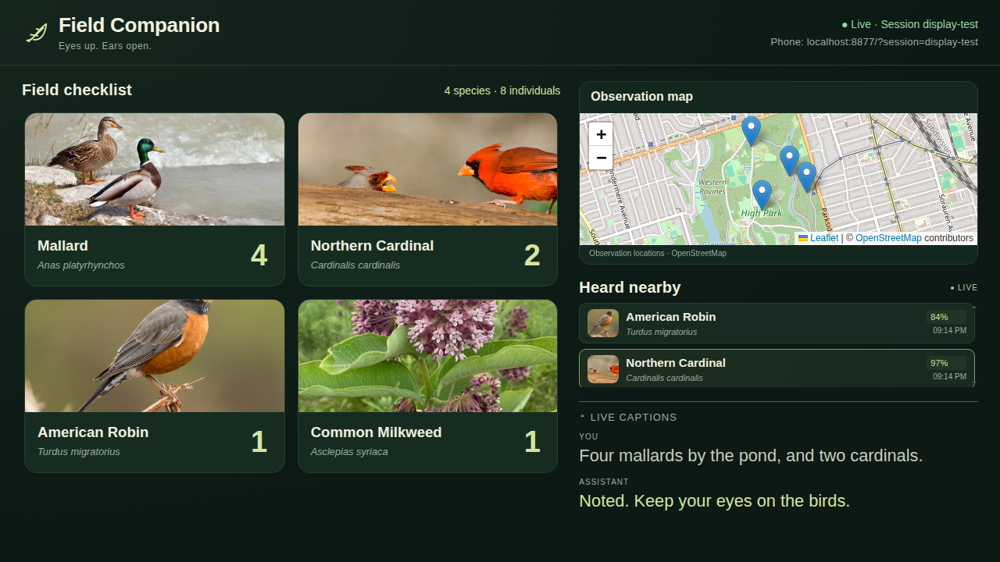
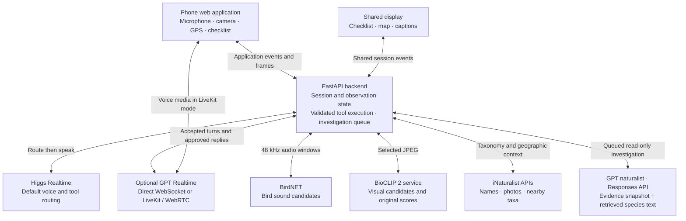

# Field Companion — Real-Time Multimodal AI Assistant for Field Naturalists

Field Companion is a voice-first AI assistant that helps birdwatchers and naturalists identify species, record observations, and ask follow-up questions without interrupting their field activities. It combines real-time conversation with dedicated audio and visual recognition, an evidence-grounded GPT naturalist, and backend-managed tools and background tasks.

A user can log a sighting, identify an unfamiliar organism, and continue talking while a longer investigation runs. The backend owns observation state and checklist writes; a model's spoken claim never substitutes for a successful tool result.

[Architecture](#system-architecture) · [Engineering](#engineering-highlights) · [Local setup](#setup-and-running-locally) · [Evaluation](#testing-and-evaluation) · [Team](#team-and-contributions)



*Repository UI preview from protocol-mock testing, with simulated observations, detections, and captions. This is not a live recognition result; newer camera and investigation screens are not pictured. [Phone interface preview](web/screenshot.png).*

## Key features

- **Hands-free observation logging:** record species and counts, correct totals, or remove entries by voice. Successful writes use a short earcon instead of unnecessary speech. English/Chinese input is supported.
- **Background bird recognition:** BirdNET analyzes microphone audio and proposes species to accept or dismiss. Recent detections remain queryable after a call ends; this queries detection history, not recorded audio. Suggestions never auto-log.
- **Camera identification across taxa:** open a preview, aim/zoom/select a region, then say **Start** or tap **Identify**. The phone selects the sharpest of up to three frames for BioCLIP 2. Look again adds evidence to the current subject; a new subject starts a separate observation. Explicit confirmation adds it to the checklist.
- **Evidence-grounded naturalist assistance:** ask about candidate differences, diet, habitat, or behavior. GPT receives bounded observation evidence and retrieved species text, with validated evidence IDs and source quotations.
- **Asynchronous investigations:** receive a task ID immediately, continue the conversation, and inspect progress, cancel, or retry. Completion produces a deferred offer to explain; it does not automatically read findings over another conversation.
- **State-aware conversation:** the optional LiveKit path provides Scout addressing, context-bound answers to assistant questions, shared dialogue memory, and an alternative Ambient mode with silent question cards.
- **Shared display and export:** mirror a phone session on a larger screen, view observations on a map, and export eBird Record Format CSV or an all-taxa CSV. The eBird export uses **Incidental** protocol; it is not a complete effort checklist or direct upload.

## System architecture



Recognition, language interpretation, and state mutation have separate responsibilities. BirdNET and BioCLIP return candidates; iNaturalist supplies context; the naturalist explains bounded evidence. The backend validates intent, consent, task identity, and current observation state before applying changes. GPT expert results cannot confirm species or change checklist counts.

Higgs remains the default configured conversation provider. GPT Realtime and LiveKit are implemented, optional paths. LiveKit carries voice through WebRTC while application events stay on the backend WebSocket. Its processed voice track and separately requested raw BirdNET capture are distinct; the UI reports bird recognition unavailable if that raw input cannot be verified. In the standard transport, a 48 kHz microphone stream feeds BirdNET and a downsampled 24 kHz copy feeds the voice provider.

## Engineering highlights

### 1. Asynchronous agent workflows

Slow expert reasoning runs outside the foreground voice worker. Each session has a bounded investigation queue with task IDs, immutable evidence snapshots, recorded stages, cancellation, linked retries, and terminal-state guards. The default is **one sequential research worker per session**, up to five active jobs, and a retained history of twenty jobs. Foreground conversation continues while research runs or waits.

Background expert requests default to 120 seconds inside a 180-second task deadline. Status queries read actual retrieval/analysis stages rather than generating progress estimates. Completed work stays attached to its original subject; a stale result cannot overwrite a newer observation. Readiness offers wait for user speech and existing playback to finish, and findings require an explicit request. See [investigation lifecycle and validation](docs/INVESTIGATIONS.md).

### 2. Stateful conversation and reliable tool execution

The backend separates detections, tentative observations, confirmed checklist records, camera requests, and investigation tasks. Routing selects a structured action; deterministic validation enforces its permissions and valid state transitions. A progress query cannot silently recapture a photo, and a retry cannot duplicate running work or target an unrelated failed task.

In LiveKit Scout mode, a new spoken request starts with **Scout**. A completed assistant question grants a context-bound reply window of up to forty seconds, allowing a relevant answer without repeating the name. An unclear addressed request asks for clarification. Both routing and speech use the same accepted-dialogue ledger: up to twenty-four recent messages / 12,000 characters, plus an asynchronously maintained 4,000-character summary. Ignored speech is excluded, and fresh backend state remains authoritative. This is session memory and application-level addressing, not persistent personal memory or an on-device wake-word detector. See [conversation behavior](docs/LIVEKIT.md#scout-addressing-and-shared-memory) and [semantic routing](docs/semantic-routing.md).

### 3. Real-time voice integration

The original Higgs integration uses **route then speak**: a text-only required-tool phase precedes any approved audio answer. A provider adapter preserves those application tools for optional GPT Realtime, including session-configuration acknowledgement and audio-format checks. Cached acknowledgements were generated with **Higgs TTS 3** and require no synthesis call per cue.

The LiveKit implementation separates a text-only GPT router from a managed speech session. Automatic speech-side answers are suppressed; authoritative tool results authorize replies. Playback ownership, cancellation guards, and matching completion signals prevent stale or overlapping audio. Scout mode authorizes interruption after addressing is accepted. Browser echo cancellation helps the voice track, while bird listening attempts unprocessed capture and excludes assistant playback windows. Standard Speaker mode retains conservative half-duplex behavior with manual interruption. **Reliable full-duplex speakerphone behavior across all devices is not established.** See [provider integration](docs/GPT_REALTIME.md), [LiveKit](docs/LIVEKIT.md), and [audio diagnostics](docs/AUDIO_LAB.md).

### 4. Multimodal evidence and evaluation

The visual pipeline preserves the user's requested category separately from the model's predicted category. It retains full-vocabulary scores alongside category-constrained rankings, so a narrow shortlist cannot turn weak original evidence into confidence. Category conflicts prompt clarification or a closer view. Camera permission and capture consent are separate, and request IDs prevent late frames from updating a different subject.

The GPT naturalist uses the Responses API with structured decisions: answer, request more evidence, clarify, or abstain. Evidence/source IDs must belong to the snapshot, and quoted passages must occur in supplied extracts. It receives **no raw images or audio**; citation checks establish provenance, not biological accuracy or semantic entailment. Regression suites and paired provider/image evaluations test these boundaries. See [expert contract](docs/EXPERT.md), [camera lifecycle](docs/CAMERA.md), and [visual safeguards](docs/VISUAL_TARGETS.md).

## Technology stack

| Layer | Implementation |
| --- | --- |
| Client | HTML/CSS/JavaScript mobile web app, WebAudio/AudioWorklet, camera APIs, Leaflet map, service-worker app shell; no frontend build step |
| Application backend | Python 3.12, FastAPI, asyncio, WebSocket signaling, in-memory session state and task orchestration |
| Conversation and media | Higgs Realtime; optional GPT Realtime; optional LiveKit Agents/WebRTC and Silero VAD; cached Higgs TTS 3 clips |
| Recognition | Server-side BirdNET; separate PyTorch/OpenCLIP BioCLIP 2 service; iNaturalist taxonomy and geographic context |
| Naturalist and memory | OpenAI Responses API, structured output validation, retrieved Wikipedia extracts, asynchronous dialogue compaction |
| Verification | Python unittest, Node audio-contract tests, Chromium/CDP browser checks, opt-in provider and recognition evaluations |

## Setup and running locally

Run commands from the repository root. Use **Python 3.12**. The frontend needs no Node installation to run; Node is used for JavaScript checks. Detailed PowerShell instructions and mock-only development are in [local development](docs/LOCAL_DEVELOPMENT.md).

### Install the base environment

Linux/macOS shell:

```bash
python3.12 -m venv .venv
.venv/bin/python -m pip install -r requirements.txt
# Optional for the base app; required for local background bird recognition:
.venv/bin/python -m pip install -r requirements-birdnet.txt
```

BirdNET adds a large TensorFlow dependency. The core installation can run without it, with bird recognition unavailable.

### Configure credentials

| Capability | Server-side configuration |
| --- | --- |
| Default Higgs conversation | `BOSON_API_KEY` in the process environment **or** `~/.config/boson/api_key`, containing only the key. Boson key loading does not read `.env.local`. |
| GPT investigations and optional GPT conversation | `OPENAI_API_KEY` in the process environment or ignored root `.env.local`. Without it, the Higgs path can still run, but the expert is unavailable; selecting GPT conversation requires it. |
| Optional LiveKit voice | `LIVEKIT_URL`, `LIVEKIT_API_KEY`, and `LIVEKIT_API_SECRET`, through the private local setup page or server environment; the setup page saves ignored `.env.livekit.local`. See [LiveKit setup](docs/LIVEKIT.md#local-setup-windows). |

**Never commit credentials or put provider keys in browser code.** Models are configurable: the current OpenAI conversation defaults are `gpt-realtime-2.1`, `gpt-transcribe`, and voice `marin`; the expert defaults to `gpt-5.4-mini`. Provider access and model availability must be checked for your account. See [GPT settings](docs/GPT_REALTIME.md#run) and [expert settings](docs/EXPERT.md#configuration-and-verification).

### Start the optional BioCLIP service

Use a **separate environment**, with CPU wheels to avoid installing the CUDA stack:

```bash
python3.12 -m venv .venv-vision
.venv-vision/bin/python -m pip install torch==2.8.0 torchvision==0.23.0 --index-url https://download.pytorch.org/whl/cpu
.venv-vision/bin/python -m pip install -r requirements-vision.txt
.venv-vision/bin/python backend/vision_service.py --port 8795 --threads 4
```

First start downloads model weights and species embeddings. Wait for readiness, then run the application in another terminal. The backend defaults to `VISION_URL=http://127.0.0.1:8795`; override that environment variable if using another service address. Without the service, photo upload can work but identification is unavailable. Keep vision loopback-only. Cache defaults are ignored `out/cache/` (`FIELD_COMPANION_CACHE`) and `out/hf-cache/` (`HF_HOME`). Windows launchers and health checks are documented in [camera setup](docs/LOCAL_DEVELOPMENT.md#camera-development).

### Choose a conversation path

For default Higgs conversation:

```bash
.venv/bin/python backend/server.py --host 127.0.0.1 --port 8765
```

Open <http://localhost:8765/>. For optional direct GPT Realtime, use a separate invocation:

```bash
.venv/bin/python backend/server.py --host 127.0.0.1 --port 8800 --realtime-provider openai
```

Open <http://localhost:8800/>. The Windows launcher is `backend/start_realtime.ps1`; see [GPT Realtime setup](docs/GPT_REALTIME.md). Each backend process has independent session state, even if the same session name is used on two ports.

For **LiveKit-managed GPT voice on Windows**, keep its SDK separate from the TensorFlow/BirdNET environment because their protobuf requirements conflict:

```powershell
py -3.12 -m venv .venv-livekit
.\.venv-livekit\Scripts\python.exe -m pip install -r requirements-livekit.txt
powershell -ExecutionPolicy Bypass -File backend/start_livekit.ps1
```

This launcher also requires `.venv` with the BirdNET dependencies above. It starts the app on port **8805**, a private authenticated BirdNET worker on **8811**, and starts or reuses BioCLIP on **8795** when `.venv-vision` exists. Use `-SkipVision` for a deliberate voice-only run. Configure the LiveKit project through the **private setup link** described in [the setup guide](docs/LIVEKIT.md#local-setup-windows), then open <http://localhost:8805/?transport=livekit&session=livekit-phone>. Project credentials stay server-side; the phone receives a short-lived room-scoped token.

### Connect a phone and shared display

Phones need HTTPS for microphone/camera access. For example, forward the default app port:

```bash
cloudflared tunnel --url http://127.0.0.1:8765
```

Use port `8800` or `8805` for the corresponding optional voice path. Open the generated HTTPS URL, allow permissions, and start listening. Use the same `?session=demo` on phone and display; `/?display=1&session=demo` mirrors the session without requesting mic or camera. Append `&audio=1` for display audio. In LiveKit mode, retain `transport=livekit` on the phone URL and allow network access to LiveKit Cloud.

Prefer the phone mic with wired earphones for initial tests. **There is no application authentication:** keep services on loopback and use a temporary trusted demo tunnel, not an unrestricted public deployment. A tunnel and LiveKit Cloud do not host the application; local processes must remain running.

## Testing and evaluation

Offline tests cover routing/tool contracts, camera consent and stale frames, observation isolation, expert output/source validation, queue scheduling and cancellation, retries, deferred delivery, Scout addressing, memory compaction, and failure recovery. Optional SDK and numerical tests need their corresponding environments. Historical test totals describe earlier revisions; use the current suite output rather than treating those counts as a current result.

```bash
# Backend regressions; no live provider calls or credentials required:
(cd backend && ../.venv/bin/python -m unittest discover -p 'test_*.py')
# Audio ownership/transport contracts and JavaScript syntax:
node --test web/test_livekit_audio.cjs web/test_audio_lab.cjs
for js in web/*.js; do node --check "$js"; done
# Torch scope tests, without loading BioCLIP model weights:
.venv-vision/bin/python -m unittest discover -s backend -p 'test_vision_service_scope.py'
```

LiveKit SDK contract tests run in `.venv-livekit`; see [the validation commands](docs/LIVEKIT.md#validation). Chromium/CDP tests use fake microphone/camera streams and fixture classifiers; [local development](docs/LOCAL_DEVELOPMENT.md#existing-tests) and [camera testing](docs/CAMERA.md) explain isolated browser setup. Mock tests do not establish physical-device acoustics or field recognition accuracy.

### Measured provider comparison

A dated paired regression compared the same application routing contract on **56 synthetic scenarios × two rounds per provider**, or **112 text trials per provider / 224 total**:

| Measurement | Higgs Realtime 1.5 preview | GPT Realtime 2.1 |
| --- | ---: | ---: |
| Correct tool and meaningful arguments | 95/112 (84.8%) | 106/112 (94.6%) |
| Median text routing time | 625 ms | 813 ms |
| P95 text routing time | 1,031 ms | 1,125 ms |

Run: **2026-10-24**, implementation/prompt snapshot `2e3bd40`, before Scout/shared-memory changes. Routing time excludes connection setup, input speech, tool execution, and playback. The benchmark did not execute recognition or checklist tools. Repeated synthetic cases are not independent field users; correct-action scores also differ from strict routing-protocol compliance. See [method, audio subset, failure cases, and reproduction](docs/REALTIME_COMPARISON.md).

### Visual and workflow evaluation

Committed BioCLIP category-policy results include a 48-image different-species holdout: unrestricted top-1 was **40/48**, versus **42/48 when the correct broad category was supplied**. Wrong results accepted by the policy fell from two to one. These are small convenience-sample, category-assisted measurements, not calibrated field-accuracy guarantees. See [visual methodology and results](docs/VISUAL_TARGETS.md#paired-image-results-2026-10-25).

LiveKit service checks exercise real API/Cloud transport with synthetic input, including addressed interruption and a full photo-to-spoken-result replay. [Reviewed phone regressions](docs/benchmarks/scout_phone_regressions.json) explicitly separate fixture failures and synthetic capture from real services. They do **not** prove physical phone echo cancellation. The [investigation validation](docs/INVESTIGATIONS.md#verification) also distinguishes a real source-backed GPT answer from a simulated long task used to test conversational responsiveness.

Opt-in live tests make external, potentially billed requests and may require licensed fixtures that are not bundled:

```bash
.venv/bin/python backend/selftest.py --serve --data-dir /path/to/fixtures
```

Expected fixtures include `img/cardinal.jpg`, or `testmix/{cardinal,robin,bluejay}_best.wav` for `--chorus`. Override with `FIELD_COMPANION_TEST_DATA`, `--image`, or `--chorus-file`. Missing fixtures print **SKIP**, not a successful live result. See [Look/expert checks](docs/LOOK_EXPERT_TESTING.md) and [historical fresh-install verification](docs/SUBMISSION.md).

## Team and contributions

Field Companion is a **two-person collaborative project**. The following areas reflect implementation and integration history; specialist models and media SDKs are external components.

- **Zihan Wang ([MacroSony](https://github.com/MacroSony))** — original FastAPI/Higgs application foundation, BirdNET integration and proactive suggestions, early routing/echo controls, shared sessions, observation/detection and fusion systems, and the initial BioCLIP service. Also developed the original diagnostics, opt-in recordings, ambient/silent-card routing, and local speaker-profile capabilities.
- **Tianlei Pang ([TianleiP](https://github.com/TianleiP))** — GPT naturalist reasoning and grounded answers; asynchronous investigations; phone camera interaction and observation follow-ups; semantic task routing, progress and retry handling; GPT Realtime and LiveKit integration; Scout addressing and shared memory; audio interruption/playback reliability improvements; visual safeguards, regression tests, and provider/model evaluation. Integrated upstream recording, speaker diagnostics, and Ambient behavior with the LiveKit workflow.

[Commit history](https://github.com/MacroSony/field-companion/commits/main/) records the original components and subsequent shared integration.

## Known limitations

- **Local prototype:** no production deployment, application authentication, or complete persistent account storage. Checklist, memory, and tasks are in process memory; restart/reset loses them. Export observations before stopping.
- **Device-dependent audio:** standard Speaker mode is half-duplex; LiveKit addressing, raw/processed capture, echo cancellation, and interruption need target-device testing. Bluetooth call-mode capture can remove birdsong detail. Broad iOS/device/field validation is incomplete.
- **Recognition uncertainty:** scores and fusion are uncalibrated. Explicit bird targets can use a local species shortlist, which can force out-of-range birds toward local look-alikes. Category hints help constrain a search but do not prove identity; the user must confirm observations.
- **Language and reasoning errors:** short/noisy speech, ambiguous references, and compound requests can misroute. Retrieved source quotations do not guarantee biological facts or correct inference.
- **Server and network dependencies:** BirdNET runs on the server; voice and expert providers need API access, and vision needs its separate service. Cached frontend assets do not provide offline recognition or durable checklist recovery.
- **Sensitive diagnostics:** turn WAV recording is opt-in and off by default. Logs can still contain transcripts; optional voice profiles are diagnostic, not authentication. Keep keys, `logs/`, `recordings/`, and `speakers/` private. See [recording and profile behavior](docs/LIVEKIT.md#conversation-modes-recordings-and-voice-profiles).

## Repository and further reading

- `backend/` — application state/tools, voice adapters, investigation queue, recognition services, and backend tests.
- `web/` — phone interface, shared display, capture/playback, camera interaction, and CSV export; [frontend notes](web/README.md).
- Current workflows: [Investigations](docs/INVESTIGATIONS.md), [Expert](docs/EXPERT.md), [Camera](docs/CAMERA.md), [LiveKit](docs/LIVEKIT.md), [Visual targets](docs/VISUAL_TARGETS.md).
- Integration and evaluation: [Local development](docs/LOCAL_DEVELOPMENT.md), [Protocol](docs/PROTOCOL.md), [GPT Realtime](docs/GPT_REALTIME.md), [Provider comparison](docs/REALTIME_COMPARISON.md), [Audio lab](docs/AUDIO_LAB.md), [Look/expert tests](docs/LOOK_EXPERT_TESTING.md), [Vision tests](docs/vision-test.md), [Issues](docs/ISSUES.md).
- Historical design/probes: [Original design](docs/DESIGN.md), [Feasibility](docs/FEASIBILITY.md), [Higgs routing probes](docs/router-test.md), [Realtime probe notes](docs/realtime-probe-report.zh.md), and `probes/`. Dated proposals and test results are not a specification of every current path.

## Project origins

The project began at the Boson AI × MScAC Higgs Audio Hackathon in October 2026. Development continued afterward with optional GPT Realtime/LiveKit voice, application-managed conversation memory, asynchronous workflows, and evaluation. Recognition builds on BirdNET and BioCLIP; taxonomy and reference context use iNaturalist and retrieved species sources.
